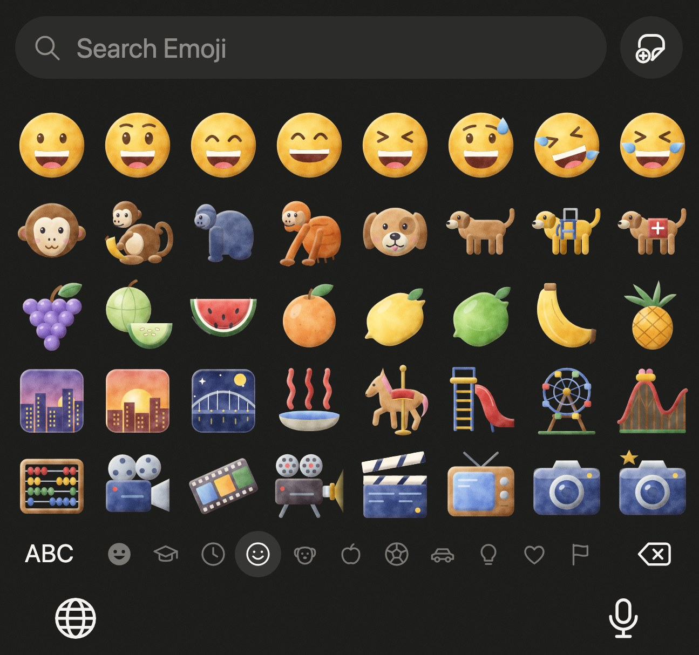

# Whiboard Emoji

1,250 emoji drawn by hand in a soft watercolour, storybook style. Every drawing is plain SVG written as code: a short function per emoji, a shared palette and two filters (a bevel and a paper grain). The set is built and checked by rendering it in headless Chromium.

It was made for the sticker menu of [Whiboard](https://whiboard.com), an online whiteboard, and works anywhere an SVG or a sprite sheet does.




[**Try them in the browser**](https://whiboard.github.io/whiboard-emoji/): search the set, put emoji on a board, copy or download any of them.

## What is in the set

| Group            | Emoji | Notes                                                  |
| ---------------- | ----- | ------------------------------------------------------ |
| Smileys          | 169   | faces, cat faces, creatures, hearts, emotion marks     |
| Animals & nature | 159   |                                                        |
| Food & drink     | 131   |                                                        |
| Activities       | 85    |                                                        |
| Travel & places  | 218   |                                                        |
| Objects          | 264   |                                                        |
| Symbols          | 224   | signs, arrows, zodiac, keycaps, letter buttons, shapes |
| Extras           | 18    | school things that are not emoji (`dist/extra/`)       |

Not drawn yet: people, hands and body parts (with their skin tones) and flags.

## Install

```sh
npm install @whiboard/emoji
```

The package is ES modules with TypeScript types. It has four entries, so an app only loads what it uses (sizes before minifying and compression):

| Import                    | What                                                                   | Size  |
| ------------------------- | ---------------------------------------------------------------------- | ----- |
| `@whiboard/emoji`         | emoji → URL of its drawing, sprite sheet cells, the id list            | 13 KB |
| `@whiboard/emoji/catalog` | names, keywords, `search()`                                            | 96 KB |
| `@whiboard/emoji/react`   | `<Emoji>`, `<EmojiProvider>`                                           | 2 KB  |
| `@whiboard/emoji/picker`  | `<EmojiPicker>` (loads the catalog), with `@whiboard/emoji/picker.css` | 9 KB  |

The SVG files and sprite sheets are in the package too: `@whiboard/emoji/svg/<code points>.svg`, `@whiboard/emoji/sprites/<group>.webp`, `@whiboard/emoji/index.json`.

## Use

### Any framework

```ts
import { emojiUrl, has, toUnified } from "@whiboard/emoji";

emojiUrl("🎉"); // "https://cdn.jsdelivr.net/npm/@whiboard/emoji@<version>/dist/svg/1f389.svg"
emojiUrl("1f389", { base: "/emoji/" }); // "/emoji/svg/1f389.svg"
emojiUrl("👍"); // null: people and hands are not drawn yet
toUnified("❤"); // "2764-fe0f", the id the set uses
has("🚀"); // true
```

```ts
import { emojis, search } from "@whiboard/emoji/catalog";

emojis.length; // 1250
search("red heart")[0]; // { unified: "2764-fe0f", char: "❤️", name: "red heart", keywords: [...], group: "smileys" }
```

### React

```tsx
import { Emoji } from "@whiboard/emoji/react";

<p>
  Shipped <Emoji emoji="🚀" /> and celebrated <Emoji emoji="🎉" size={32} />
</p>;
```

`<Emoji>` renders an `` of the drawing, the size of the text around it unless `size` says otherwise. An emoji the set has no drawing of is rendered as the emoji itself, or as `fallback`. It takes every `` attribute (`className`, `style`, `title`, `onClick`…). React 17 or newer.

A picker, by group, with search:

```tsx
import { EmojiPicker } from "@whiboard/emoji/picker";
import "@whiboard/emoji/picker.css";

<EmojiPicker onSelect={(emoji) => insert(emoji.char)} theme="auto" />;
```

`onSelect` receives `{ unified, char, name, keywords, group, url }`. Props: `width`, `height`, `cellSize`, `theme` (`"light"`, `"dark"`, `"auto"`), `searchPlaceholder`, `autoFocus`, `emptyText`, `className`, `style`. Its colours are CSS variables (`--we-bg`, `--we-fg`, `--we-muted`, `--we-border`, `--we-hover`, `--we-accent`, `--we-radius`): set them on `.we-picker` to match your app.

### Where the files come from

By default every URL points at the `dist/` folder of the installed version of the package on the jsDelivr CDN. To serve the files yourself, copy `node_modules/@whiboard/emoji/dist/svg` and `dist/sprites` to your site and say where they are:

```tsx
import { EmojiProvider } from "@whiboard/emoji/react";

<EmojiProvider base="/emoji/">
  <App />
</EmojiProvider>;
```

Outside React, pass `{ base: "/emoji/" }` to `emojiUrl`, `spriteUrl`, `spriteCell` and `spriteStyle`. With a bundler you can also import a single file and let it handle the asset:

```ts
import rocket from "@whiboard/emoji/svg/1f680.svg"; // a URL in Vite, webpack, Parcel…
```

### Without npm

Everything is committed under `dist/`:

- `dist/svg/<code points>.svg`: one file per emoji. The name is the emoji's code points in lower-case hex joined by `-`, variation selectors included, the way [emoji-picker-react](https://github.com/ealush/emoji-picker-react) writes its `unified` id: 😀 is `1f600.svg`, ❤️ is `2764-fe0f.svg`. Each file is self-contained (100 × 100 viewBox, its gradients and the filters inside).
- `dist/sprites/<group>.webp`: the same drawings as one sheet per group, 80 px cells.
- `dist/index.json`: the groups in picker order. Per group `id`, `label`, `sprite`, `cols` (cells per row of its sheet) and `stickers`, one `[code points, name, keywords]` per emoji in the order of the sheet, so sticker `i` sits at column `i % cols`, row `floor(i / cols)`.

### Two things to know before you ship them

- **The filters cost time.** One drawing paints in a few milliseconds, which is nothing for an image and far too much for a grid of two hundred or a canvas that repaints every frame. Use the sprite sheets for pickers (`<EmojiPicker>` does, `spriteStyle()` gives you the CSS), and draw from a bitmap (rasterise the SVG once per size) on a canvas.
- **They are made for dark and light grounds.** Nothing is pure black or pure white: "black" things are a warm dark grey, "white" things are cream, so every drawing keeps its edge on `#1b1b1a` and on `#f4f1ea`.

## Build

The repository is TypeScript throughout. The scripts are run by `node` as they are (it strips the types), so they need Node 24 or newer; packages are installed with [Bun](https://bun.sh); the drawing checks and the sprite sheets also need the Chromium that Playwright installs.

```sh
bun install
bunx playwright install chromium     # only for check.ts, sprites, sheets and docs

node build.ts                        # dist/svg, dist/extra, coverage per group
node build.ts --sprites              # + dist/sprites, dist/index.json
node scripts/package-data.ts         # src/generated (the package's id list and names) from dist/index.json
bun run build:lib                    # the npm package: src/ → lib/
node build.ts --sheets all           # review pages, 40 emoji each: dist/sheets/<group>-NN.png
node build.ts --overview             # dist/sheets/all.png, every emoji in one picture
node build.ts --docs                 # the two pictures in this README
node build.ts --install <dir>        # copy svg + sprites + index.json into an app

bun run typecheck                    # kits and tools (strict), drawings, package
bun run test                         # the built package: helpers, search, React components
```

The review sheets and `lib/` are not committed; `dist/svg`, `dist/sprites`, `dist/index.json` and `src/generated` are, and CI fails when they are not what the drawings build.

## Release

`.github/workflows/publish.yml` publishes `@whiboard/emoji` to npm when a version tag is pushed. It runs the same checks as CI first, refuses a tag that is not the version in `package.json`, and does nothing when that version is already on npm.

```sh
bun pm version patch                  # or minor / major: bumps package.json, rewrites src/generated, commits, tags vX.Y.Z
git push origin main --follow-tags    # the tag starts the publish
```

One-time setup on npm, either of:

- **Trusted publishing (no secret to keep).** npm only lets you set it up for a package that exists, so publish once by hand (`npm login`, then `npm publish --access public` in this folder), then on npmjs.com open the package → Settings → Trusted Publisher → GitHub Actions: organization `Whiboard`, repository `whiboard-emoji`, workflow `publish.yml`, and allow `npm publish`. A new configuration must publish successfully within two days or it expires.
- **A token.** Create a granular access token that can publish to the `@whiboard` scope and save it as the repository secret `NPM_TOKEN` (GitHub → Settings → Secrets and variables → Actions). The workflow uses it when no trusted publisher answers.

The npm organization `whiboard` has to exist and you have to be able to publish to it.

## How a drawing is written

A batch file exports a list of emoji. `draw` returns the SVG body for a 100 × 100 box; gradients come from the helpers it is given, colours from the palette `C`, and every solid part sits in a bevel group (`B` for big parts, `Bs` for small ones):

```ts
// batches/<name>.ts
import type { Icon } from "../kit.ts";
import { B, Bs, C } from "../kit.ts";

const batch: Icon[] = [
  {
    u: "1f514", // code points, copied from the assignment
    n: "bell",
    draw: ({ lin }) => `
<g ${B}><path d="M50 12 C30 12 24 32 24 52 L16 72 H84 L76 52 C76 32 70 12 50 12Z" fill="${lin([C.gold, C.goldM, C.goldD])}"/></g>
<g ${Bs}><circle cx="50" cy="82" r="8" fill="${lin([C.goldM, C.goldD])}"/></g>`,
  },
];

export default batch;
```

Faces and signs are assembled from parts, so a whole family changes in one place:

```ts
import { both, brow, drop, eye, head, mouth } from "../facekit.ts";
import { ink, label, tile } from "../symkit.ts";

// 😢
(t) => head(t) + both(eye.dot) + both(brow, { tilt: -6 }) + mouth.curve({ y: 74, w: 11, d: -5 }) + drop(t, 31, 62);
// 🆗
(t) => tile(t, "blue") + ink(label("OK", { h: 36 }));
```

The kits are typed, so a tone that does not exist or an option a part does not take is a compile error. The rules of the style are in the header of [`kit.ts`](kit.ts) and they are binding: fill the box (the larger side spans 84 to 92 units), one clear silhouette that still reads at 40 px, light from the top-left, no outlines, no `<text>` (letters and digits are stroke paths from `symkit.ts`), no `<image>`, `<use>`, `<style>`, `class`, `id` or `href`.

## Check

```sh
node check.ts batches/school.ts                     # the whole batch
node check.ts batches/school.ts --only 1f514,23f0   # a close look at a few
```

The checker refuses what the rules forbid, parses each drawing as XML, measures what is actually painted (an error outside the box, a warning when too small, off-centre or touching the edge), lists assigned emoji that are still missing and writes a contact sheet to `out/check/` with every drawing on the dark and on the light ground. The label under each drawing shows your system's emoji next to the name, only as a reminder of the subject.

## Add or redraw an emoji

1. `node assign.ts <picker category> <batches>` writes `data/<category>.json` and splits the emoji that have no drawing yet into `data/assign/<category>-N.json`.
2. Write `batches/<category>-N.ts` with one entry per assigned emoji, checking as you go.
3. To replace a drawing, put the new one in a `batches/00-polish-N.ts` file: files named `00-*` win over every other batch, the highest number first.
4. `node build.ts --sprites && node scripts/package-data.ts`, look at the sheets, commit `batches/`, `dist/` and `src/generated/`.

## Layout

| Path                              | What                                                                       |
| --------------------------------- | -------------------------------------------------------------------------- |
| `src/`                            | the npm package: helpers, catalog, React components (built to `lib/`)      |
| `src/generated/`                  | its id list and names, written by `scripts/package-data.ts`                |
| `kit.ts`                          | palette, bevel and grain filters, gradient helpers, the style rules        |
| `facekit.ts`                      | one head and the eyes, brows and mouths every face is made of              |
| `symkit.ts`                       | tiles, discs, a stroke font, arrows for signs and symbols                  |
| `batches/`                        | the drawings, about 36 emoji per file                                      |
| `batches/symbols-gen.ts`          | 127 symbols generated from tables (arrows, media buttons, keycaps, shapes) |
| `data/`                           | emoji lists per group and the batch assignments                            |
| `assign.ts`                       | splits a picker category into batches                                      |
| `check.ts`                        | validates a batch and renders its contact sheet                            |
| `build.ts`                        | merges the batches into `dist/`                                            |
| `scripts/`                        | shared code of the checker and the build, the package data generator       |
| `test/`                           | tests of the built package                                                 |
| `draw-category.workflow.js`       | the script that ran the drawing agents (see below)                         |
| `dist/`, `docs/`                  | the built set and the README pictures                                      |
| `index.html`                      | the preview page, published by `.github/workflows/pages.yml`               |

## How the set was drawn

The drawings were written by AI coding agents (Claude, through Claude Code), not produced by an image model: each agent got one batch, the kit and the reference drawings, wrote the SVG by hand, rendered it with the checker, looked at the result and fixed it. `draw-category.workflow.js` is the orchestration script that was used, one agent per batch plus redraw passes for drawings flagged weak. A person reviewed every sheet. No vendor's emoji artwork was copied or traced; the system emoji in the check sheets only names the subject.

## Licence

- **Artwork**: the drawings in `batches/` and everything generated from them (`dist/`, `docs/`) are licensed under [Creative Commons Attribution 4.0 International](https://creativecommons.org/licenses/by/4.0/), see [`LICENSE-ARTWORK`](LICENSE-ARTWORK). A line such as "Emoji artwork by Whiboard, CC BY 4.0" with a link to this repository is enough.
- **Code**: the kits, the checker and the build scripts are under the MIT licence, see [`LICENSE`](LICENSE).
- The emoji names and keywords in `data/` come from the data shipped with emoji-picker-react (MIT), which derives them from Unicode's CLDR.
