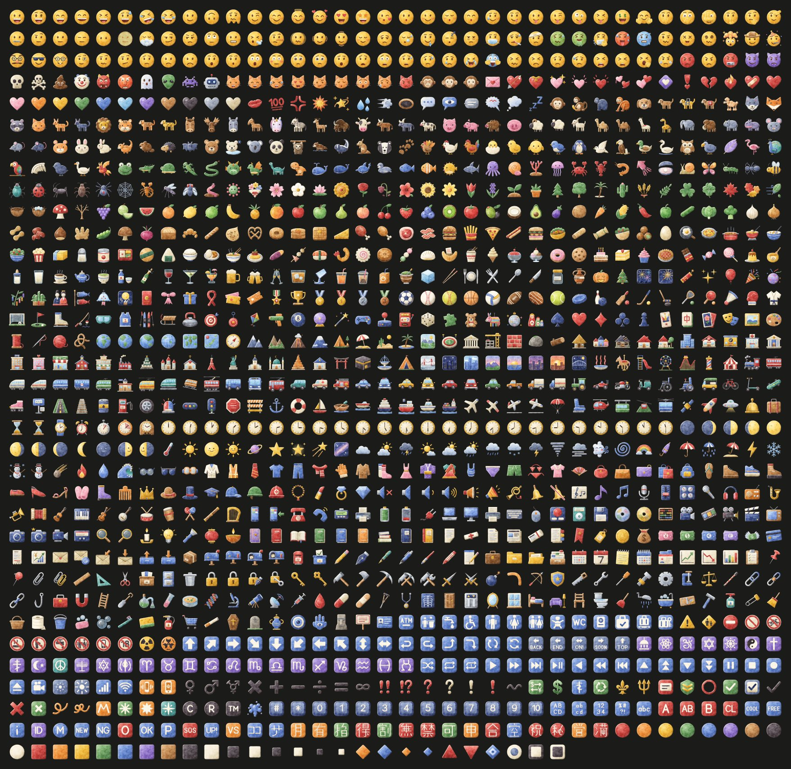

# Whiboard Emoji

1,250 emoji drawn by hand in a soft watercolour, storybook style. Every drawing is plain SVG written as code: a short function per emoji, a shared palette and two filters (a bevel and a paper grain). The set is built and checked by rendering it in headless Chromium.

It was made for the sticker menu of [Whiboard](https://whiboard.com), an online whiteboard, and works anywhere an SVG or a sprite sheet does.




## What is in the set

| Group            | Emoji | Notes                                                        |
| ---------------- | ----- | ------------------------------------------------------------ |
| Smileys          | 169   | faces, cat faces, creatures, hearts, emotion marks           |
| Animals & nature | 159   |                                                              |
| Food & drink     | 131   |                                                              |
| Activities       | 85    |                                                              |
| Travel & places  | 218   |                                                              |
| Objects          | 264   |                                                              |
| Symbols          | 224   | signs, arrows, zodiac, keycaps, letter buttons, shapes       |
| Extras           | 18    | school things that are not emoji (`dist/extra/`)             |

Not drawn yet: people, hands and body parts (with their skin tones) and flags.

## Use the drawings

Everything you need is committed under `dist/`; you do not have to build.

- `dist/svg/<code points>.svg`: one file per emoji. The name is the emoji's code points in lower-case hex joined by `-`, variation selectors included, the way [emoji-picker-react](https://github.com/ealush/emoji-picker-react) writes its `unified` id: 😀 is `1f600.svg`, ❤️ is `2764-fe0f.svg`. Each file is self-contained (100 × 100 viewBox, its gradients and the filters inside).
- `dist/sprites/<group>.webp`: the same drawings as one sheet per group, 80 px cells.
- `dist/index.json`: the groups in picker order. Per group `id`, `label`, `sprite`, `cols` (cells per row of its sheet) and `stickers`, one `[code points, name, keywords]` per emoji in the order of the sheet, so sticker `i` sits at column `i % cols`, row `floor(i / cols)`.

Two things to know before you ship them:

- **The filters cost time.** One drawing paints in a few milliseconds, which is nothing for an image and far too much for a grid of two hundred or a canvas that repaints every frame. Use the sprite sheets for pickers, and draw from a bitmap (rasterise the SVG once per size) on a canvas.
- **They are made for dark and light grounds.** Nothing is pure black or pure white: "black" things are a warm dark grey, "white" things are cream, so every drawing keeps its edge on `#1b1b1a` and on `#f4f1ea`.

## Build

You need Node 20 or newer (or Bun) and the Chromium that Playwright installs.

```sh
bun install                          # or: npm install
bunx playwright install chromium     # or: npx playwright install chromium

node build.mjs --sprites             # dist/svg, dist/extra, dist/sprites, dist/index.json
node build.mjs --sheets all          # review pages, 40 emoji each: dist/sheets/<group>-NN.png
node build.mjs --overview            # dist/sheets/all.png, every emoji in one picture
node build.mjs --docs                # the two pictures in this README
node build.mjs --install <dir>       # copy svg + sprites + index.json into an app
```

`node build.mjs` alone writes `dist/svg` and `dist/extra` and prints the coverage per group. The review sheets are large PNGs and are not committed.

## How a drawing is written

A batch file exports a list of emoji. `draw` returns the SVG body for a 100 × 100 box; gradients come from the helpers it is given, colours from the palette `C`, and every solid part sits in a bevel group (`B` for big parts, `Bs` for small ones):

```js
// batches/<name>.mjs
import { B, Bs, C } from "../kit.mjs";

export default [
  {
    u: "1f514", // code points, copied from the assignment
    n: "bell",
    draw: ({ lin }) => `
<g ${B}><path d="M50 12 C30 12 24 32 24 52 L16 72 H84 L76 52 C76 32 70 12 50 12Z" fill="${lin([C.gold, C.goldM, C.goldD])}"/></g>
<g ${Bs}><circle cx="50" cy="82" r="8" fill="${lin([C.goldM, C.goldD])}"/></g>`,
  },
];
```

Faces and signs are assembled from parts, so a whole family changes in one place:

```js
import { both, brow, drop, eye, head, mouth } from "../facekit.mjs";
import { ink, label, tile } from "../symkit.mjs";

// 😢
(t) => head(t) + both(eye.dot) + both(brow, { tilt: -6 }) + mouth.curve({ y: 74, w: 11, d: -5 }) + drop(t, 31, 62);
// 🆗
(t) => tile(t, "blue") + ink(label("OK", { h: 36 }));
```

The rules of the style are in the header of [`kit.mjs`](kit.mjs) and they are binding: fill the box (the larger side spans 84 to 92 units), one clear silhouette that still reads at 40 px, light from the top-left, no outlines, no `<text>` (letters and digits are stroke paths from `symkit.mjs`), no `<image>`, `<use>`, `<style>`, `class`, `id` or `href`.

## Check

```sh
node check.mjs batches/school.mjs                     # the whole batch
node check.mjs batches/school.mjs --only 1f514,23f0   # a close look at a few
```

The checker refuses what the rules forbid, parses each drawing as XML, measures what is actually painted (an error outside the box, a warning when too small, off-centre or touching the edge), lists assigned emoji that are still missing and writes a contact sheet to `out/check/` with every drawing on the dark and on the light ground. The label under each drawing shows your system's emoji next to the name, only as a reminder of the subject.

## Add or redraw an emoji

1. `node assign.mjs <picker category> <batches>` writes `data/<category>.json` and splits the emoji that have no drawing yet into `data/assign/<category>-N.json`.
2. Write `batches/<category>-N.mjs` with one entry per assigned emoji, checking as you go.
3. To replace a drawing, put the new one in a `batches/00-polish-N.mjs` file: files named `00-*` win over every other batch, the highest number first.
4. `node build.mjs --sprites`, look at the sheets, commit `batches/` and `dist/`.

## Layout

| Path                         | What                                                                        |
| ---------------------------- | --------------------------------------------------------------------------- |
| `kit.mjs`                    | palette, bevel and grain filters, gradient helpers, the style rules         |
| `facekit.mjs`                | one head and the eyes, brows and mouths every face is made of               |
| `symkit.mjs`                 | tiles, discs, a stroke font, arrows for signs and symbols                   |
| `batches/`                   | the drawings, about 36 emoji per file                                       |
| `batches/symbols-gen.mjs`    | 127 symbols generated from tables (arrows, media buttons, keycaps, shapes)  |
| `data/`                      | emoji lists per group and the batch assignments                             |
| `assign.mjs`                 | splits a picker category into batches                                       |
| `check.mjs`                  | validates a batch and renders its contact sheet                             |
| `build.mjs`                  | merges the batches into `dist/`                                             |
| `lib/`                       | shared code of the checker and the build, the keyboard page of the sheets   |
| `draw-category.workflow.js`  | the script that ran the drawing agents (see below)                          |
| `dist/`, `docs/`             | the built set and the README pictures                                       |

## How the set was drawn

The drawings were written by AI coding agents (Claude, through Claude Code), not produced by an image model: each agent got one batch, the kit and the reference drawings, wrote the SVG by hand, rendered it with the checker, looked at the result and fixed it. `draw-category.workflow.js` is the orchestration script that was used, one agent per batch plus redraw passes for drawings flagged weak. A person reviewed every sheet. No vendor's emoji artwork was copied or traced; the system emoji in the check sheets only names the subject.

## Licence

- **Artwork**: the drawings in `batches/` and everything generated from them (`dist/`, `docs/`) are licensed under [Creative Commons Attribution 4.0 International](https://creativecommons.org/licenses/by/4.0/), see [`LICENSE-ARTWORK`](LICENSE-ARTWORK). A line such as "Emoji artwork by Whiboard, CC BY 4.0" with a link to this repository is enough.
- **Code**: the kits, the checker and the build scripts are under the MIT licence, see [`LICENSE`](LICENSE).
- The emoji names and keywords in `data/` come from the data shipped with emoji-picker-react (MIT), which derives them from Unicode's CLDR.
